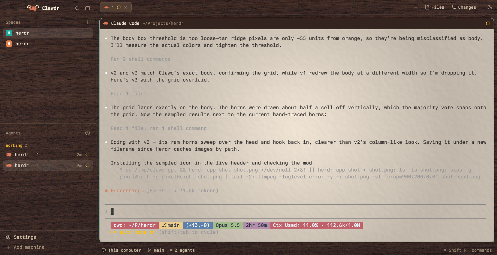

# Woody Herdr

A look for the [Herdr](https://herdr.dev) desktop app: terminals on textured parchment paper, framed in dark walnut, with an orange Clawd and "Clawdr" in the corner, a sun/moon light/dark toggle and a paper texture dropdown in the tab bar, and Claude Code sessions that start in colours that suit the paper.



## What you get

- **Paper behind every terminal.** Parchment (`#f4e8d8`) in light mode, dark graphite paper in dark mode. The default is a still render of a Ghostty paper shader: soft vignette, inner shadow, film grain and embossed fibres.
- **A choice of paper textures.** A dropdown at the right of the tab bar picks the paper behind the panes: the shader paper, three parchments made with gpt-image-2 (fibre, mottled, fine), or plain. The parchments have the shader paper's colour and vignette, with real paper fibre in place of its embossed pattern.
- **A wooden frame in light mode.** Dark walnut behind the sidebar, tab bar, status bar and the channels around the cards, with cream text. Two other light frames come with it: light oak and brushed steel.
- **A sun/moon toggle** at the right end of the tab bar. Click to switch between light and dark; right-click to follow macOS again.
- **Clawdr branding.** The sidebar header shows Claude Code's orange Clawd, with curled ram horns, and the name Clawdr.
- **Pane headers and side panels that read on the paper.** Each pane's header is a walnut strip with the program's icon and name in cream, and an agent's own title (Claude Code's `/rename`) instead of "Claude Code". The Files and Changes panels sit on the walnut frame too. In Files, a markdown file opens rendered, with a Source/Preview button in the panel header; links to other files in the folder open in the panel, and web links open in the browser.
- **Agents sorted by when you last looked.** The sidebar's Agents list puts the agent you've gone longest without opening at the top, whatever its state, so `cmd-]` (next agent) takes you round all of them. The one you're on keeps its place and drops to the bottom once you move to another. Herdr's Priority and Grouped by space sorts are still in the list's sort menu.
- **Terminals above Agents.** The sidebar has no Spaces list. A Terminals list above Agents shows each space with no agent in it. Its + opens a new space with a plain shell; once you start Claude Code there, the space moves down to Agents. Hover a terminal row for an x that closes it.
- **Claude Code in matching colours.** A launcher starts Claude Code with a parchment theme when Herdr is light: Claude's light theme with the prompt band, the bash-message rows and the other near-white backgrounds in paper shades, so they don't show as grey-white stripes on the paper.
- **Claude Code sessions that save their transcripts.** Herdr's pane shells start through a small wrapper that drops the session markers Claude Code puts on its children. Without it, opening the Herdr app from a shell inside a Claude session makes every Claude started in Herdr a transcript-less child of that session ("Transcript saving is off — inherited CLAUDE_CODE_CHILD_SESSION marker"). The launcher drops them too.
- **Berkeley Mono Dotted** for terminals and panels, if you have it.

Dark mode is Herdr's own graphite look plus the dark paper.

## The paper-and-ink version

A second layout, `paper-desk`, is installed beside the first. It is the same window with everything on it made of paper, tape and ink:

- **Agents and terminals are paper cards** lying on the walnut, typed in ink. A strip of coloured ink down a card's left edge says which space it belongs to, and the time since you last looked is a pencil note.
- **Status is an ink mark.** A brushed ring turns while an agent works and darkens over its first quarter of an hour, a blue tick means done, a pencil circle means idle, and an agent that needs you gets a red NEEDS YOU rubber stamp.
- **Pane headers are masking tape.** The agent's title is handwritten on a strip of tape stuck to the top of the paper, with the folder in pencil beside it and the same ink marks at the right.
- **The tab bar is paper and tape.** Tabs are slips of paper; +, Files, Changes, the paper texture dropdown and the sun/moon are handwritten or brushed on tape, and the dropdown opens as a sheet of paper.
- **What sits on the wood is printed.** The name Clawdr, the sidebar's headings and the status bar are set in a printer's small caps. Settings and Add machine at the foot of the sidebar are slips of paper.
- **The icons are painted.** Twenty brush-and-ink icons (file, branch, layers, cog, search, the pane buttons and the rest) replace Herdr's line icons on the tape, the cards, the slips and the wood. gpt-image-2.6 painted them on one sheet, and `art/make-ink-icons.py` cut the sheet up and traced each one.
- **Two alert sounds**, a counter bell for an agent that needs you and two knocks on wood for one that finished. They are optional: see below.

It works in light and dark; the cards take the terminal's own paper and ink colours, and the tape stays cream.

Switch to it, and back:

```sh
herdr-app do layout.switch --name paper-desk
herdr-app do layout.switch --name paper-grain
```

To use the sounds, add this to `~/.config/herdr-app/settings.json` (it applies in every layout); `afplay ~/.config/herdr-app/sounds/desk-bell.mp3` plays one first:

```json
"sounds": { "enabled": true, "blocked": "sounds/desk-bell.mp3", "done": "sounds/wood-knock.mp3" }
```

`art/make-desk-art.py` redraws the marks, the stamp and the tape (it needs ImageMagick: `brew install imagemagick`), `art/make-ink-icons.py` re-cuts the icons from `art/ink-icons/ink-icons-sheet.png` (ImageMagick and potrace: `brew install potrace`), and `sounds/make-sounds.sh` remakes the sounds (ffmpeg).

## Install

These steps start from a Mac with none of it installed. Herdr's macOS builds need Apple Silicon. Skip any step you've already done.

1. **Homebrew.** Install it from [brew.sh](https://brew.sh) if `brew --version` doesn't answer. It also installs Apple's command line tools, which give you `git`.

2. **The Herdr desktop app.**

   ```sh
   brew install --cask herdr-app
   ```

   Open Herdr once from Applications, so it creates its home folder, `~/.config/herdr-app`, and leave it open. It updates itself after that. The look was built on 0.1.9 and is checked against 0.1.13, which it needs: the Agents list, Files and Changes panels are copies of 0.1.13's.

3. **Claude Code.**

   ```sh
   brew install --cask claude-code
   claude
   ```

   Run `claude` once in a terminal to sign in, then quit it.

4. **`~/.local/bin` on your PATH.** The installer puts the Claude launcher there, and Herdr's + menu finds programs through your login shell's PATH. If `echo $PATH` doesn't show `~/.local/bin` (as `/Users/<you>/.local/bin`), add this line to `~/.zprofile`, then quit and reopen Herdr and your terminal:

   ```sh
   export PATH="$HOME/.local/bin:$PATH"
   ```

5. **This repo.**

   ```sh
   git clone https://github.com/RobGruhl/woody-herdr.git
   cd woody-herdr
   ./install.sh
   ```

   The script copies the two layouts, the ten mods, the themes, the images and the sounds into Herdr's home, installs the Claude launcher and the pane shell wrapper into `~/.local/bin` and the parchment theme into `~/.claude/themes`, adds `programs.json` so Herdr's + menu starts Claude Code through the launcher, writes `~/.config/herdr-core/config.toml` so new terminals start through the wrapper, and switches the window to the `paper-grain` layout. It never overwrites: if any file it would write already exists, it stops and lists them. At the end it says if `~/.local/bin` isn't on your PATH or Claude Code isn't installed. `ctrl-shift-l` cycles back to your previous layout.

6. **Settings.** Open `~/.config/herdr-app/settings.json` (Herdr creates it) and add these, keeping your other keys:

   ```json
   "font": "Berkeley Mono Dotted",
   "ui_font": "Berkeley Mono Dotted",
   "minimum_contrast": 1.0
   ```

   Berkeley Mono is a paid font from [U.S. Graphics](https://usgraphics.com/products/berkeley-mono); install its files with Font Book. Without it, leave `font` and `ui_font` out to get Herdr's default font, or name any monospace font you have. `minimum_contrast` 1.0 is Herdr's default and the value the look was made with. Above 1.0, Herdr swaps terminal text colours it finds too faint for near-black or near-white.

7. **Quit and reopen Herdr**, from the Dock, Spotlight or Finder rather than from a terminal. herdr-core reads `config.toml` when it starts, so the shell wrapper takes effect from then on.

8. **Start Claude Code** from Herdr's + menu. Restart any Claude Code sessions that were already running, so they pick up the launcher.

You only need Node and ffmpeg (`brew install node ffmpeg`) to re-render the textures, below.

Prefer to have an agent do it? Point it at this repo: `RECIPE.md` is a brief for adding it by hand or building it from scratch.

### Updating

Pull, then copy what changed over Herdr's copies; `install.sh` won't overwrite, so it can't do this. For example, after `git pull`:

```sh
H=~/.config/herdr-app
for m in mods/*/; do mkdir -p "$H/$m"; cp "$m"mod.json "$H/$m"; cp -R "$m"* "$H/$m"; done   # mod.json first, as install.sh does
cp themes/*.json "$H/themes/"; cp backgrounds/* "$H/backgrounds/"
cp layouts/paper-grain.json layouts/paper-grain.png layouts/paper-desk.json layouts/paper-desk.png "$H/layouts/"
mkdir -p "$H/sounds"; cp sounds/*.mp3 "$H/sounds/"
cp bin/claude-herdr-app bin/herdr-shell ~/.local/bin/; cp claude/themes/parchment.json ~/.claude/themes/
```

Copying the layout resets the paper texture and light-mode frame written in that file; `paper-sync` writes your choices back when Herdr reloads the layout. If you changed the layout's theme to oak or steel, set it again. Copy a mod folder only into a mod of the same name: Herdr's own `pane`, `files`, `changes`, `agents` and `workspace-chrome` stay as they are.

## Using it

- **Light and dark:** the sun/moon button. Right-click it to follow macOS instead of choosing.
- **Paper texture:** the dropdown just left of the sun/moon button. Click a row, or press its number while the menu is open. The choice applies in light and dark and is kept across restarts. `paper-texture.next`, `paper-texture.prev` and `paper-texture.open` are key commands you can bind in `keys.json`.
- **The light-mode frame:** walnut is the default. For oak or steel, set the light half of the layout's theme in `layouts/paper-grain.json` to `gruvbox-light` (oak) or `gruvbox-light-steel` (steel): `"theme": { "light": "gruvbox-light", "dark": "graphite" }`, and back to `walnut-parchment` for walnut.
- **Claude Code colours:** a session keeps the colours it started with, because Herdr doesn't tell programs when its appearance changes. Restart Claude after toggling.

## Re-rendering the textures

`backgrounds/render-paper.mjs` draws the paper and steel textures (Node, no dependencies):

```sh
cd ~/.config/herdr-app/backgrounds
node render-paper.mjs --bg '#f4e8d8' --out paper-light-f4e8d8.png
node render-paper.mjs --style steel --bg '#dce4ed' --width 2560 --height 1440 --out steel-light.png
```

The parchments come from `backgrounds/grade-parchment.mjs`, which needs ffmpeg (`brew install ffmpeg`). It takes a gpt-image-2 draft, keeps its fibre and mottling, lays them on the paper colour, and adds the shader paper's vignette. The drafts aren't in this repo (like the walnut and oak drafts); `RECIPE.md` has the prompt, and the script's header has the settings:

```sh
node grade-parchment.mjs --in parchment_v1.png --out paper-light-gen-v1.png --texture 5
node grade-parchment.mjs --in parchment_v1.png --out paper-dark-gen-v1.png --bg '#17191d' --texture 1.7
```

Give every new render a new file name and update the texture table in `mods/paper-sync/main.js` to match: Herdr caches images by path, so a file rewritten in place keeps showing the old picture. A new row in that table also shows up in the dropdown.

## What's in here

| Path | What it is |
|---|---|
| `layouts/paper-grain.json` | The layout: a copy of Herdr's `main` with the paper, the see-through frame, the toggle and the Clawdr header |
| `layouts/paper-desk.json` | The paper-and-ink layout: the same window, with props that turn on the cards, tape and ink in the mods below, and `paper-tabs` and `paper-status` in place of Herdr's tab bar and status bar |
| `mods/paper-tabs`, `mods/paper-status` | Herdr's tab bar as paper slips and tape labels, and its status bar in small caps (paper-desk only) |
| `mods/paper-pane/fonts` | Caveat Brush (the handwriting) and IM Fell English SC (the small caps), both under the SIL Open Font License |
| `sounds/` | The counter bell and the wood knock, and the script that synthesises them |
| `art/make-desk-art.py` | Draws paper-desk's ink marks, rubber stamp, tape ends and brushed sun and moon |
| `mods/paper-pane/ink`, `art/ink-icons/`, `art/make-ink-icons.py` | paper-desk's twenty painted icons as tintable SVGs, the sheet gpt-image-2.6 painted, and the script that cuts and traces it |
| `mods/paper-sync` | Swaps the paper and frame images to match the chosen texture, the appearance and the light theme (an invisible floating block); holds the texture table |
| `mods/paper-texture` | The paper texture dropdown |
| `mods/appearance-toggle` | The sun/moon button |
| `mods/clawdr-chrome` | Herdr's sidebar header with the horned Clawd and the name Clawdr |
| `mods/paper-agents` | Herdr's Agents list with a "Least recently viewed" sort and two-line rows (space, then the agent's title), plus a Terminals list above it for spaces with no agent, whose + opens a new shell space |
| `mods/paper-pane` | Herdr's pane header on the walnut `surface`, showing an agent's own title |
| `mods/paper-files`, `mods/paper-changes` | Herdr's Files and Changes panels on the see-through `chrome`, so the walnut frame shows behind them; Files also renders markdown |
| `art/` | How the horned Clawd was made: the edit target script, gpt-image-2's picture, the grid overlay, and the sampler that writes `mods/clawdr-chrome/clawd-ram-gpt.svg` |
| `themes/walnut-parchment.json` | Light mode: a parchment background, walnut panels with cream text, Gruvbox Light terminal colours |
| `themes/gruvbox-light.json`, `themes/gruvbox-light-steel.json` | The oak and steel light themes |
| `backgrounds/` | Paper, parchment, walnut, oak and steel images, the paper/steel renderer, and the parchment grader |
| `bin/claude-herdr-app` | Starts Claude Code with the parchment theme when Herdr is light (Claude's light theme if `parchment.json` isn't installed), without inherited Claude Code session markers |
| `bin/herdr-shell` | The shell herdr-core starts in each new terminal: drops inherited Claude Code session markers, then execs the login shell |
| `claude/themes/parchment.json` | The Claude Code theme the launcher uses in light mode: Claude's light theme with four backgrounds in paper shades |
| `programs.json` | Makes Herdr's + menu start Claude Code with the launcher |
| `RECIPE.md` | The full brief: every size, colour and behaviour, and what trips a rebuild up |

## Credits

Made by Rob Gruhl ([RobGruhl](https://github.com/RobGruhl)) with Claude Code. The paper is a still port of Rob's Ghostty shader `subtle-paper-vignette.glsl`. The walnut, oak and parchment textures were generated with gpt-image-2. Terminal colours are the [Gruvbox](https://github.com/morhetz/gruvbox) palette. gpt-image-2 drew the horns onto the Claude Code icon Herdr ships, and `art/sample-clawd-grid.py` sampled the picture back onto the icon's pixel grid. Six parts are modified copies of Herdr's own, and some icons are copied from it, under Herdr's Apache 2.0 licence: see `NOTICE.md`.
