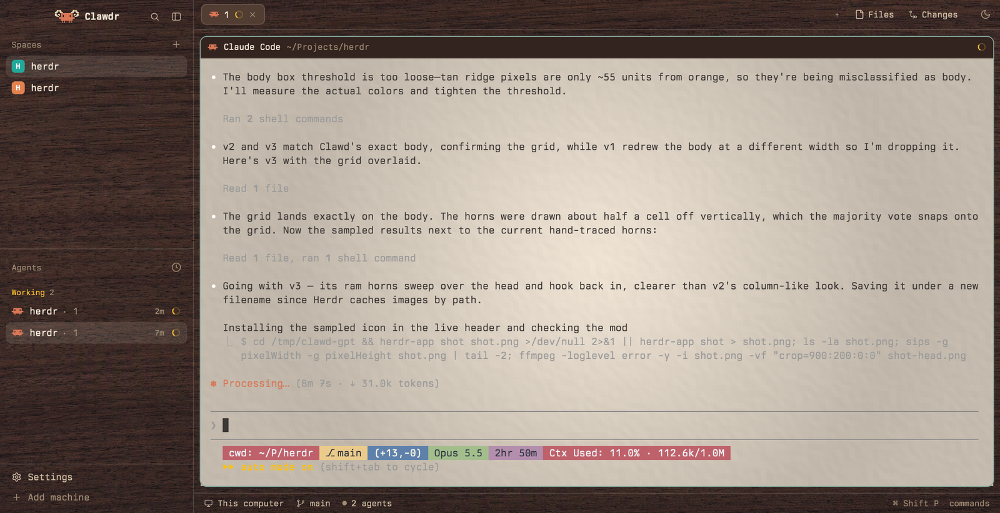

# Woody Herdr

Herdr's main window with every terminal sitting on a sheet of textured paper. In light mode the paper is warm parchment inside a dark walnut frame with cream text; in dark mode it is dark graphite paper inside Herdr's own graphite look. The sidebar header shows Claude Code's orange Clawd and the name "Clawdr", a sun/moon button at the right of the tab bar flips light and dark, a dropdown beside it picks the paper texture, and Claude Code sessions started from Herdr come up in colours that suit the paper.



## What you see

Left to right, as designed at zoom 1 (Herdr scales every size by the person's zoom):

- **Sidebar, 268 px wide** (min 44, max 480, not resizable). Top: a 46 px header row with Clawd wearing ram horns (`mods/clawdr-chrome/clawd-ram-gpt.svg`, drawn 33×18) and "Clawdr" in semibold `foreground`, then the search and sidebar-toggle buttons. Middle: the `paper-agents` block, filling the height (min 90 px); Herdr's spaces list is left out. At its top, a Terminals header (11.5 px, `dim`) with a 22 px + button that runs `space.new` with no arguments, then a 46 px two-line row for each space with no agent in it (the space's name, then its program's name in 12 px `dim`; click focuses it, an x on hover runs `space.close`). Below that, the Agents header with the sort button and the agents list, which scrolls. A space leaves Terminals for Agents as soon as an agent in it reports a status. Bottom: Herdr's 69 px footer (Settings, Add machine).
- **Work column.** Top: a 42 px row with Herdr's tab bar filling it, then a 112 px block holding the texture dropdown's button (26 px high, 8 px side padding, 6 px corners, pushed to the block's right edge: a 14 px layers icon, the texture's short name in 12.8 px text, a 12 px chevron, 6 px apart, in `dim`; `hover` behind it and `foreground` text on hover), then a 40 px block holding the sun/moon button (a 26 px square, 6 px corners, icon 15 px in `dim`, `hover` behind it on hover). Both blocks paint `chrome` with a 1 px `border` line along the bottom. Middle: the shown tab's panes, 8 px padding and 8 px gaps, each pane a square-cornered card (radius 0) with a 1 px `border` edge (`accent` when focused) and a 30 px pane header on top, even when a tab has one pane. The header is a walnut (`surface`) strip with the program's icon and name in `foreground` cream; for an agent the name is its own terminal title (Claude Code's `/rename`, or its topic) when it has one. The Files/Changes panel (368 px, hidden until opened) sits to the right, painted in `chrome` so the walnut frame shows through behind its cream file names. In Files, a markdown file opens rendered, with a Source/Preview button in the panel header. Bottom: Herdr's 28 px status bar.
- **Behind each terminal:** a paper texture filling the card (`cover`), with the terminal's own background fully transparent (`terminal_opacity` 0). The paper has a soft round vignette (about 2.5% darker at the centre, 20% at the corners), a thin 2% inner shadow near the edges, film grain (about ±0.9%), and embossed fibres on roughly 14 px cells lit from the upper left. Light: rendered on `#f4e8d8`. Dark: on `#17191d`. That is "Shader paper", the default. The dropdown offers four more:
  - **Parchment, fibre / mottled / fine:** three gpt-image-2 parchments (soft cloudy fibre with small flecks; broader blotches; thin hair-like fibres). Each keeps only its draft's texture, on the same base colours and with the same vignette, inner shadow and curl crest as the shader paper, so their averages match it within one level (light about `#ccc2b4`, dark `#131518`). The texture's luma spread is 5 levels (8-bit) in light and 1.7 in dark, against about 1.5 for the shader paper's grain. 2560×1440.
  - **Plain, no texture:** flat `#f4e8d8` in light, `#17191d` in dark.
- **Behind everything else in light mode:** one 2560×1440 image covering the whole window (`cover`), showing through the sidebar, the bars and the channels between cards, because the light themes' `chrome` colour is fully transparent. Walnut by default (deep chocolate brown, about `#382824` on average, fine horizontal grain); oak (pale honey white oak, about `#e4c9a6`) or brushed steel (`#dce4ed` with fine horizontal hairlines, broad rolling marks, grain and a 4% sheen from the upper left) as alternatives. In dark mode the window behind is the plain `canvas` colour.
- **Type:** Berkeley Mono Dotted for terminals and panels (`font` and `ui_font` in settings.json).

Light mode, `walnut-parchment` (a parchment background, walnut panels with cream text, Gruvbox Light terminal colours):

| Role | Colour |
|---|---|
| `background` (the terminal's own background, and what Claude Code's `auto` theme is told; Herdr's own pane header and Files/Changes panels would paint it too, which is why those are cloned) | `#f4e8d8` |
| `chrome` | `#33241f00` (see-through) |
| `canvas` | `#3a2824` |
| `surface` (pane headers) | `#33241f` |
| `raised` / `popover` | `#523d33` / `#3d2c26` |
| `hover` / `selected` / `border` / `input` | `#f2e8d812` / `#f2e8d81c` / `#f2e8d824` / `#f2e8d838` |
| `foreground` / `muted` / `dim` | `#f2e8d8` / `#cdbba3` / `#a08c74` |
| `accent` / `accent_foreground` / `done` | `#83a598` / `#1d2021` / `#83a598` |
| `working` / `blocked` / `idle` | `#fabd2f` / `#fb4934` / `#8f7d68` |
| `solid` / `solid_foreground` | `#f2e8d8` / `#33241f` |
| terminal text (top-level `foreground`, and `terminal_foreground`) / cursor / selection | `#3c3836` / `#3c3836` / `#d5c4a1` |
| ANSI 0–15 | `#f4e8d8 #cc241d #98971a #d79921 #458588 #b16286 #689d6a #7c6f64 #928374 #9d0006 #79740e #b57614 #076678 #8f3f71 #427b58 #3c3836` |

Oak, `gruvbox-light` (light-class): `background` `#f4e8d8`, `chrome` `#e4c9a600`, `canvas` `#e4c9a6`, `raised`/`popover` `#f7f1e6`, `hover`/`selected`/`border`/`input` `#3b2a1a` at 14/1f/2b/45 alpha, `foreground` `#2b241c`, `muted` `#5b4c3b`, `dim` `#7a6852`, `idle` `#9a8a75`, `accent`/`done` `#076678`; terminal colours as above.

Steel, `gruvbox-light-steel` (light-class): as oak but `chrome` `#dce4ed00`, `canvas` `#cfd9e4`, `raised` `#eef2f7`, `popover` `#f1f4f8`, `hover`/`selected`/`border`/`input` `#2a4a6a` at 14/1f/2b/45 alpha, `foreground` `#1c2733`, `muted` `#4f6275`, `dim` `#7d8fa3`, `idle` `#8a9aab`.

Dark mode is Herdr's `graphite` preset, unchanged.

## How it behaves

- **Sun/moon button:** shows the sun while dark (click for light) and the moon while light (click for dark). Clicking writes `"appearance"` to settings.json the way Herdr's Settings does (read, change, write only if nobody changed it meanwhile). Right-clicking removes `"appearance"` so Herdr follows macOS. `appearance-toggle.toggle` and `appearance-toggle.system` are key commands for keys.json.
- **Texture dropdown:** pressing the button opens a 250 px popup under it, right edges aligned, 6 px below. On `popover`, 5 px padding, 12.8 px text: a header "Paper behind the panes" (11 px, `dim`), then one 31 px row per texture (9 px side padding, 7 px corners, `selected` on hover): a 14 px `accent` check on the current one, its name in `foreground`, and its number (1–5) on the right in 11 px `dim`. Clicking a row or pressing its number picks it and closes the popup; Esc or a click outside closes it. The choice is kept in shared state (`shared.json`, key `paper.texture`), so it holds across restarts and in both appearances. Key commands for keys.json: `paper-texture.next`, `paper-texture.prev` (step through, wrapping) and `paper-texture.open` (opens the popup under the button, or at the pointer if the button hasn't been pressed since the mod loaded).
- **When the look changes** (appearance flips, a different light theme is picked, or a texture is chosen), the layout's images swap within about a second: the chosen texture's light or dark paper behind the panes, and behind the window the walnut, oak or steel for the light theme in use, or `canvas` in dark mode.
- **Agent status** is Herdr's own: `working` spinners, `blocked` and `done` dots on tabs and in the agents list, in the theme's status colours above. Nothing here changes how status is reported.
- **Claude Code** started from Herdr's + menu (or by running `claude-herdr-app`) uses the `parchment` theme (Claude's light theme if `parchment.json` isn't installed) when Herdr is light and its usual `auto` theme otherwise, for that session only. A session keeps the colours it started with.
- **Files panel links:** in a rendered markdown file, a link to another file under the panel's folder opens that file in the panel; `http`, `https` and `mailto` links open in the browser; other links do nothing.
- Everything else (panes, splits, dragging, menus, what the Files and Changes panels list) is Herdr's.

## Built from

**The layout,** `layouts/paper-grain.json`: a clone of Herdr's `main` layout (`layout.clone`, version 0.1.9), changed in these places:

- Root: `"theme": { "light": "walnut-parchment", "dark": "graphite" }`, `"terminal_opacity": 0`, `"preview": "layouts/paper-grain.png"`, `"background"` (`"canvas"` in dark mode, `{ "image": "backgrounds/walnut.png", "fit": "cover" }` in light; paper-sync keeps it current), and `"floating": [{ "id": "paper-sync", "content": { "mod": "paper-sync" }, "edge": "bottom", "align": "end" }]`.
- The `brand` block's mod is `clawdr-chrome` instead of `workspace-chrome`. The footer keeps `workspace-chrome` with `{ "footer": true }`.
- The `agents` block's mod is `paper-agents` instead of `agents`, and the `files` and `changes` blocks' mods are `paper-files` and `paper-changes`.
- The `tabs` block sits inside a new row `tabs-row` (42 px, not resizable), followed by a 112 px block `texture` showing `paper-texture` and a 40 px block `appearance` showing `appearance-toggle`.
- The `main` block's pane frame `background` is `{ "image": "backgrounds/paper-light-f4e8d8.png", "fit": "cover" }` (or the chosen texture's image, or a plain colour; paper-sync keeps it current), its `radius` is 0, and its header's mod is `paper-pane` instead of `pane`.

**The mods:**

- `paper-sync` (`mod.json` `{"place":"none"}`): renders an empty `div()`, which hides a floating block. It holds the texture table: for each texture an `id` (saved, so kept stable), a `name` and `short` name for the dropdown, and a `light` and `dark` look, each an image path or a plain `#rrggbb`. In `init` it publishes `[{id, name, short}]` as `shared("paper.textures")` (only when that differs from what's there). On every render it works out the look from `settings()` and `shared("paper.texture")` (an unknown or missing id means the first texture): the texture and `dark` pick the paper (an image becomes `{ "image": …, "fit": "cover" }`, a colour is used as it is); in light mode `settings().theme` picks the frame (`walnut-parchment` → `backgrounds/walnut.png`, `gruvbox-light` → `backgrounds/wood-light.png`, `gruvbox-light-steel` → `backgrounds/steel-light.png`, anything else → `"canvas"`). When that differs from what it last applied, it reads `layouts/paper-grain.json` with `readTextFile`, sets the root `background` and the `main` block's pane `background`, and writes it back with `writeTextFile(path, text, expected)`, retrying up to three times if the file changed in between. It writes nothing when the file already matches.
- `paper-texture` (`{"place":"none"}`): the dropdown above. One mod plays both parts: in the layout block it draws the button and runs the `nextCommand()` loop; opened as a popup (`openOverlay({ mod: "paper-texture", kind: "popup", width: 250, height: 46 + 31 × textures, at })`, where `at` comes from the `bounds` of the button's `on_mouse_down` event) it draws the menu. It tells the two apart by `props()?.overlay` in `init`. It reads the list from `shared("paper.textures")`, writes the choice with `setShared("paper.texture", id)`, and closes itself with `closeOverlay(props().overlay)`. Its `layers.svg`, `chevron-down.svg` and `check.svg` are copies of Herdr's `workspace-chrome` icons.
- `appearance-toggle` (`{"place":"none"}`): the button above; `sun.svg` and `moon.svg` are 24 px stroke icons. Uses `settings`, `theme`, `appHome`, `readTextFile`, `writeTextFile`, `nextCommand`.
- `paper-agents` (`{"place":"none"}`): Herdr's `agents` cloned with `mod.clone` (version 0.1.13), with three changes. (1) A third sort, `viewed` ("Least recently viewed", `eye.svg`), first in `SORTS` and so the default when `shared("agents.sort")` is unset. On each render `look()` finds the agent you're on (`a.focused`, else `focused().agent` followed up `parent` to a listed agent); when that changes to another agent it stamps the one you left with `Date.now()` in `localStorage` `viewed` (entries for agents gone 30 days are dropped) and keeps the current one in `looking`. Focus on a mod pane doesn't count as leaving. The list sorts by that stamp ascending (never seen first), then `seq` ascending, under one "Least recently viewed" header with a count; each row shows the time since its stamp, and none on the focused row. `setAgentOrder` gets that order, so `agent.next` goes round every agent. (2) Rows without a space header above (this sort, priority, pinned) are 46 px and two lines: the space name, then the tab name or the agent's own title in 12 px `dim`. (3) Sort icons are full paths (`mods/workspace-chrome/clock.svg`, `layers.svg`, `mods/paper-agents/eye.svg`), and the sort popup is 172 px tall for three rows.
- `paper-pane` (`{"place":"none"}`): Herdr's `pane` cloned with `mod.clone` (version 0.1.12), with three changes. (1) The header row's `.bg(t.background)` is `.bg(t.surface)`, so with the parchment background the cream name stays on walnut. (2) For an agent, the name is `told(p)` when it returns one: the pane's `title` with any leading non-letter, non-digit characters (a spinner glyph) stripped, unless that's empty, equal to the program's name or key, a path (`~`, `/` or a drive letter at the start) or contains `@` (user@host); otherwise Herdr's usual name. (3) The name's `max_w` is 360 instead of 260. Icon paths point at `mods/paper-pane/`.
- `paper-files` (`{"place":"none"}`): Herdr's `files` cloned with `mod.clone` (version 0.1.13). The panel's `.bg(t.background)` is `.bg(t.chrome)`. Files ending `.md`, `.markdown`, `.mdown`, `.mkd` or `.mdx` open in `TextView.markdown(...)` (from `gpui-base`; selectable, scrollable, 13 px `foreground`, 16 px side and 12 px top/bottom padding) instead of the code view, with an 11 px "Source"/"Preview" button (`muted`, 1 px `border`, 6 px corners, `hover` behind it) at the right of the panel header to switch. The file's text is kept (truncated at 400,000 characters as Herdr does) for the preview. `on_link_click`: `http`, `https` and `mailto` go to `open` (`xdg-open` on Linux, `explorer` on Windows); a relative link resolves against the file's folder, an absolute one must be under the panel's root, `..` may not climb above the root, and the target opens in the panel; any other scheme is ignored. Icon paths point at `mods/paper-files/`.
- `paper-changes` (`{"place":"none"}`): Herdr's `changes` cloned with `mod.clone` (version 0.1.13). The panel's `.bg(t.background)` is `.bg(t.chrome)`.
- `clawdr-chrome`: Herdr's `workspace-chrome` cloned with `mod.clone` (version 0.1.9), with two changes in its header row: `image("frame/welcome/herdr.png").size(20).rounded(5)` became `image("mods/clawdr-chrome/clawd-ram-gpt.svg").w(33).h(18)`, and `.child("Herdr")` became `.child("Clawdr")`.

Herdr's own mods used unchanged: `tabs`, `workspace-chrome` (footer), `workspace-status`.

**Themes:** the three files in `themes/`, values above. The Gruvbox Light palette is copied from Ghostty's bundled `Gruvbox Light` theme, with its background (the top-level `background`, and ANSI 0) changed to parchment and its dark text selection replaced by `#d5c4a1`, because Herdr's theme files have no selected-text colour.

**Settings** (the person's settings.json): `"font": "Berkeley Mono Dotted"`, `"ui_font": "Berkeley Mono Dotted"`, `"minimum_contrast": 1.0`.

**Programs:** `programs.json` sets `"claude": { "run": ["claude-herdr-app"] }`. `bin/claude-herdr-app` (bash) reads `appearance` from settings.json with `plutil` (absent: `defaults read -g AppleInterfaceStyle`), then runs `claude`, adding `--settings '{"theme":"custom:parchment"}'` when light and `${CLAUDE_CONFIG_DIR:-~/.claude}/themes/parchment.json` exists, else `--settings '{"theme":"light"}'`. `--settings` adds to `~/.claude/settings.json` for that session without changing it. `claude/themes/parchment.json` is a Claude Code custom theme with `"base": "light"` and four overrides: `userMessageBackground` `#e4dacc`, `userMessageBackgroundHover` `#ece3d6`, `composerSidebarBackground` `#e9e0d2`, `bashMessageBackgroundColor` `#e8dad0`.

**Art:**

- `backgrounds/render-paper.mjs` (Node, no dependencies) writes RGB PNGs. `--style paper` ports `subtle-paper-vignette.glsl` (a Shadertoy-style Ghostty shader) at `iTime = 0`: vignette `VIGNETTE_STRENGTH` 0.20 and `VIGNETTE_SOFTNESS` 0.90 on aspect-corrected distance, inner shadow 0.02, grain 0.018 (a per-pixel hash plus smoothed noise at `fragCoord * 0.07`, masked off in near-black and near-white), emboss 0.014 from the noise gradient lit from the upper left, page-curl 0.004 (highlights only). Dropped from the shader: the glyph drop-shadow and focus framing. `--style steel` adds hairlines (noise at `x*0.004, y`, 4% peak to peak), bands (`x*0.0015, y*0.2`, 2.5%), grain (1%) and a diagonal sheen (4%) to a base colour. Papers are 1920×1200; steel is 2560×1440.
- `backgrounds/paper-light-gen-v1..3.png` and `backgrounds/paper-dark-gen-v1..3.png`, from `backgrounds/grade-parchment.mjs` (Node, with ffmpeg to decode and encode) run on three gpt-image-2 drafts (quality high, 2560×1440, `-n 3`, prompt below; the drafts aren't in this repo). For each channel it divides the draft by a wide blur of itself (three box passes of radius 80 px, close to a Gaussian with an 80 px standard deviation), which removes the draft's own tint, lighting and any vignette; scales what's left so its luma spread is `--texture` levels; softly clips anything past 3 standard deviations (`tanh`) so stray flecks can't stand out; multiplies it onto `--bg`; then applies render-paper.mjs's vignette, inner shadow and curl crest. Light: `--texture 5` on `#f4e8d8`. Dark: `--bg '#17191d' --texture 1.7`. The drafts came back at about `#efe3ce`, `#efe1cb` and `#e9decc` (slightly yellower than the paper), which the flattening throws away.

```
Intended use: a full-pane background texture behind a terminal in a desktop app. Small dark monospace text sits on top of it, so it must be calm, even and low in contrast.
Subject: a photorealistic top-down flatbed scan of one continuous flat sheet of real parchment paper. Its colour is a warm off-white, like antique white or linen: warm and slightly rosy-tan, never yellow, never green.
Details: fine natural fibre texture and soft, faint cloudy mottling visible up close, a gentle hand-made paper tooth, very subtle darker flecks of fibre. No stains, no foxing spots, no burns, no torn or deckled edges, no folds, no creases, no writing, no ink.
Lighting and framing: perfectly even diffuse scanner lighting, no vignette, no shadows, no glare, no page curl. The paper fills the image edge to edge.
Constraints: no objects, no text, no logos, no watermark, no border or frame.
```

- `mods/clawdr-chrome/clawd-ram-gpt.svg`: horns drawn by gpt-image-2 on Herdr's Claude Code icon, sampled back onto the icon's pixel grid (below).
- `backgrounds/walnut.png` and `backgrounds/wood-light.png`: gpt-image-2, quality high, 2560×1440, prompt below, one of three variants each. Their averages are about `#382824` and `#e4c9a6`.

```
Intended use: a full-window background texture for a desktop app's frame. Small light cream interface text sits on top of it, so it must be calm, even, low in contrast and fairly dark overall.
Subject: a photorealistic top-down photograph of one continuous flat surface of dark American black walnut, a deep chocolate brown with subtle warm purple-brown undertones, with fine straight grain running horizontally across the whole image and a gentle, subtle figure.
Details: matte oiled finish, real wood pores and fibre texture visible up close, soft muted grain, no knots, no cracks, no plank seams, no light sapwood streaks.
Lighting and framing: camera pointing straight down, perfectly even diffuse lighting, no vignette, no shadows, no reflections or glare. The wood fills the image edge to edge.
Constraints: no objects, no text, no logos, no watermark, no border or frame.
```

The oak prompt is the same with "Small dark interface text", "calm, even and low in contrast", and "light natural white oak, a pale honey colour", and without the sapwood clause.

**The horned Clawd,** `mods/clawdr-chrome/clawd-ram-gpt.svg`: 24×13 cells of 1.5 units (viewBox 36×19.5, `shape-rendering="crispEdges"`), one `rect` per filled cell. `O` is the body, `#D97757` (Clawd's 16×10 map at columns 4–19, rows 3–12, eyes left as holes); `H` is ivory, `#EFE4CC`; `R` is tan, `#B89B70`:

```
..HRRH............HRRH..
.RHRRHR..........RHRRHR.
HHH..HHH........HHH..HHH
RR....OOOOOOOOOOOO....RR
HH.HH.OOOOOOOOOOOO.HH.HH
HHR.H.OO.OOOOOO.OO.H.RHH
.RHH..OO.OOOOOO.OO..HHR.
....OOOOOOOOOOOOOOOO....
....OOOOOOOOOOOOOOOO....
......OOOOOOOOOOOO......
......OOOOOOOOOOOO......
.......O.O....O.O.......
.......O.O....O.O.......
```

It was made in three steps:

1. `art/make-clawd-target.py` draws Herdr's Claude Code icon (`icons/claude.svg`) at 32 px per pixel, low and centred on a flat `#2A2A2A` 1024×1024 canvas.
2. gpt-image-2 edits that picture (quality high, size auto, three variants) with the prompt below. `art/clawd-ram-gpt.png` (1254×1254) is the variant kept: its horns curl back in most clearly, and its body samples to exactly Clawd's map.
3. `art/sample-clawd-grid.py` takes the body's bounding box (pixels within 30 RGB units of `#D97757`) as 16 columns by 10 rows, 39.12 × 37.90 px in this picture, and extends that grid over the whole picture. Each cell gets the palette colour most of its middle 60% agrees on, or nothing where that is the background. The script checks the body cells against Clawd's map and writes the SVG. `art/clawd-ram-gpt-grid.png` is the picture with the grid and the sampled colours drawn on.

```
This is a pixel-art character drawn on a strict grid of 32 x 32 px square pixels, on a flat dark grey background. Change: give it a pair of curled ram horns, like a bighorn ram. One horn on each side, growing from the top corners of the head, sweeping up and outward, then curling down and back in a tight spiral beside each side of the head. The two horns are mirror images of each other. Each horn curl fits in roughly a 6 x 6 block of grid squares. Style: the same chunky pixel art as the body. Every horn pixel is a whole 32 x 32 px square aligned exactly to the existing pixel grid. Flat colours only: pale ivory bone (#EFE4CC) with darker tan (#B89B70) ridge bands running across the horn. Preserve: the orange body exactly as it is: same position, size, shape and colour (#D97757), the same two dark eye holes, the same four legs. The background stays flat solid #2A2A2A everywhere else. Constraints: no anti-aliasing, no gradients, no shading, no outlines, no shadows, no glow, no text, no other changes.
```

## Watch out

- **Write a mod's `mod.json` before its `main.js`.** Herdr docks a mod folder it hasn't seen into the shown layout as a 320 px panel the moment `main.js` appears without a `mod.json`. With `{"place":"none"}` first, it docks nothing. If it happens, delete the extra root child (its id is a long hex string) from the layout.
- **Herdr caches images by path.** Re-rendering a texture into the same file name leaves the old picture on screen. Give each render a new name and point paper-sync at it.
- **Keep `minimum_contrast` at 1.0.** Herdr measures terminal text against the theme's `background`, not against the paper you see, and replaces text below the ratio with near-black or near-white. When `background` was walnut, 4.5 turned the `#3c3836` text near-white on the parchment; the look hasn't been checked above 1.0 since `background` became parchment.
- **The theme's `background` is parchment, its panel text cream.** Herdr applies one theme to the whole window. The terminal's background has to be light, or Claude Code's `auto` theme picks dark and its inline code comes out pale lavender on the paper. But Herdr's own `pane` header and `files` and `changes` panels fill themselves with `background` and write in `foreground`, so with parchment there the cream names vanish. Hence the three clones: the header on `surface` (walnut) and the panels on `chrome` (see-through to the walnut frame), the way the sidebar already is.
- **Don't edit Herdr's own mods in place.** On its next start Herdr moves an edited built-in mod to `<name>-edited` and puts its own back. Clone it (`herdr-app do mod.clone --name pane --as paper-pane`) and point the layout at the clone.
- **The theme picker** sorts themes into light and dark by their `background`. With a walnut background it filed `walnut-parchment` as dark, so `app.theme` and Settings → Look set it as the dark half; with parchment it should count as light, but that hasn't been rechecked. Setting it in the layout's `theme.light` by editing the file works either way, and a deliberate file edit beats an earlier theme pick.
- **Claude Code never hears about appearance changes in Herdr.** A terminal on screen reports Herdr's theme background (and `#282c34` for a moment before it is shown), keeps reporting it after the appearance flips, and gets no mode 2031 change events. Claude's `auto` theme therefore picks dark at start and stays there, hence the launcher. The parchment `background` doesn't make the launcher unnecessary: a terminal that isn't on screen yet (one started with `hc run`) still reports `#282c34`. Restart sessions after toggling.
- **Mod commands sent right after a layout-file edit** (`herdr-app do appearance-toggle.toggle`) are sometimes dropped while the mod copies reload. Wait a few seconds and send it again. The same goes for back-to-back texture commands: each choice makes paper-sync rewrite the layout, and commands sent without a gap got dropped or misapplied. About 1.5 s apart, each one stepped once.
- **A mod opened as its own popup must check `props()` in `init`,** not `init`'s first argument, which didn't carry `overlay`. Checking the argument, the popup copy took the button's branch and started its own `nextCommand()` loop, and one `paper-texture.open` left three popups on screen, each showing a `track_focus` error.
- **Plain uses explicit colours, not the theme's `background`,** so it stays `#f4e8d8` and `#17191d` whichever light theme or dark preset is in use.
- **gpt-image-2 doesn't keep a pixel grid.** Given the 1024 px target it returned 1254 px pictures, each variant at its own pixel size. One redrew Clawd's body in other proportions. The kept one drew its horns about half a cell off the body's grid, squeezed the head rows a little, and painted a faint grid of its own into the background. Fitting a period to the colour edges locks onto fractions of the real cell, so anchor the grid on the body's box instead. Count only pixels close to the orange: the tan is about 55 RGB units away. Reject a variant whose sampled body differs from Clawd's map.
- **Images fill a node with `cover`**: scaled and cropped, never tiled, and Herdr can't stretch a picture's middle while keeping its edges. The vignette is per pane, so a narrow split loses some side darkening, and the frame can't have mitred corners around each card.
- **Clones don't update.** `paper-grain` and `clawdr-chrome` are copies of Herdr 0.1.9's `main` and `workspace-chrome`, `paper-pane` of 0.1.12's `pane`, and `paper-agents`, `paper-files` and `paper-changes` of 0.1.13's `agents`, `files` and `changes`; Herdr's later changes to those won't reach them. `cloned_from` in each `mod.json` records the version.
- **`herdr-app shot` shows the last frame Herdr drew.** While the window is in the background it can stop drawing, so a shot taken then shows the window as it was minutes earlier. Check that the terminal text in the shot is current before trusting it.
- **Platform:** the launcher uses macOS `plutil` and `defaults`. The layout, mods and themes are Herdr's and aren't macOS-specific.

## Done when

- `herdr-app check` passes for `paper-sync`, `paper-texture`, `appearance-toggle`, `clawdr-chrome`, `paper-agents`, `paper-pane`, `paper-files` and `paper-changes`, and `herdr-app status` shows `"layout": "paper-grain"` with `"errors": []`.
- In light mode, `layouts/paper-grain.json` has the walnut image as the root `background` and `paper-light-f4e8d8.png` as the pane background; in dark mode, `"canvas"` and `paper-dark.png`.
- `herdr-app shot` in light mode shows walnut through the sidebar, the tab bar and the status bar, cream sidebar text, dark terminal text on parchment, a walnut header with a cream name on each pane, and the horned Clawd plus "Clawdr" at the top left. Opening the Files panel shows cream file names on walnut, and a markdown file in it shows rendered, with a "Source" button.
- Picking each texture in the dropdown sets `paper.texture` in `shared.json` and, within a second, the `main` pane `background` in `layouts/paper-grain.json` to its image (`paper-light-gen-v1.png` for fibre in light mode, and so on) or, for Plain, `"#f4e8d8"`; the button shows the texture's short name and the menu checks it.
- Clicking the sun switches to light and the button becomes a moon; clicking the moon switches back; right-clicking removes `appearance` from settings.json.
- Setting `theme.light` to `gruvbox-light-steel` swaps the frame to steel within a second; `gruvbox-light` gives oak.
- The sidebar shows Terminals above Agents and no Spaces list. Clicking the + beside Terminals opens a new space with a shell, listed under Terminals; running `claude-herdr-app` in it moves the space to Agents once Claude reports a status.
- A Claude Code session started from the + menu while Herdr is light shows the parchment theme: Claude's light theme (dark text and darker gold accents) with its prompt band in a paper shade, not grey-white. After `/rename` the pane header shows the new name.
